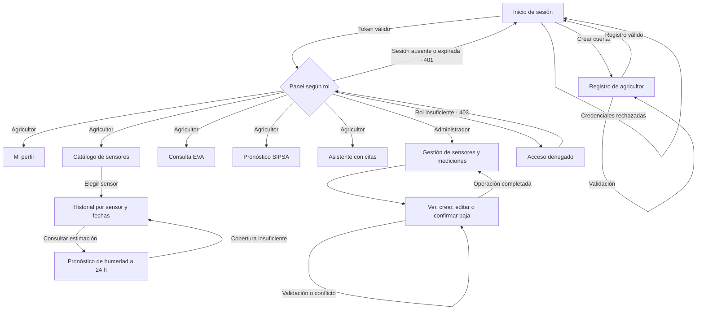
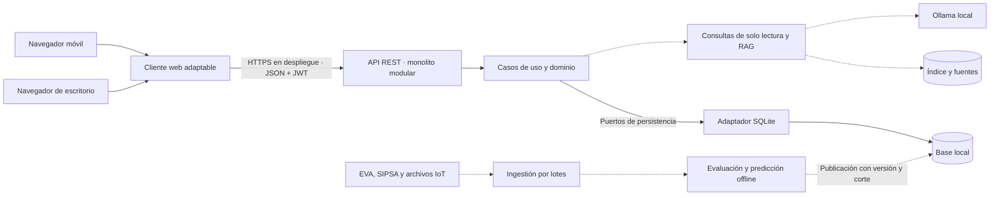
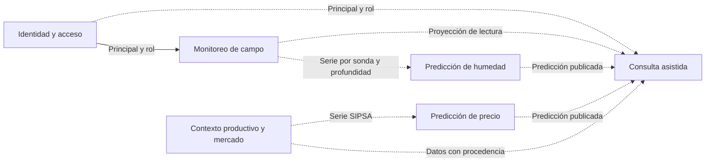
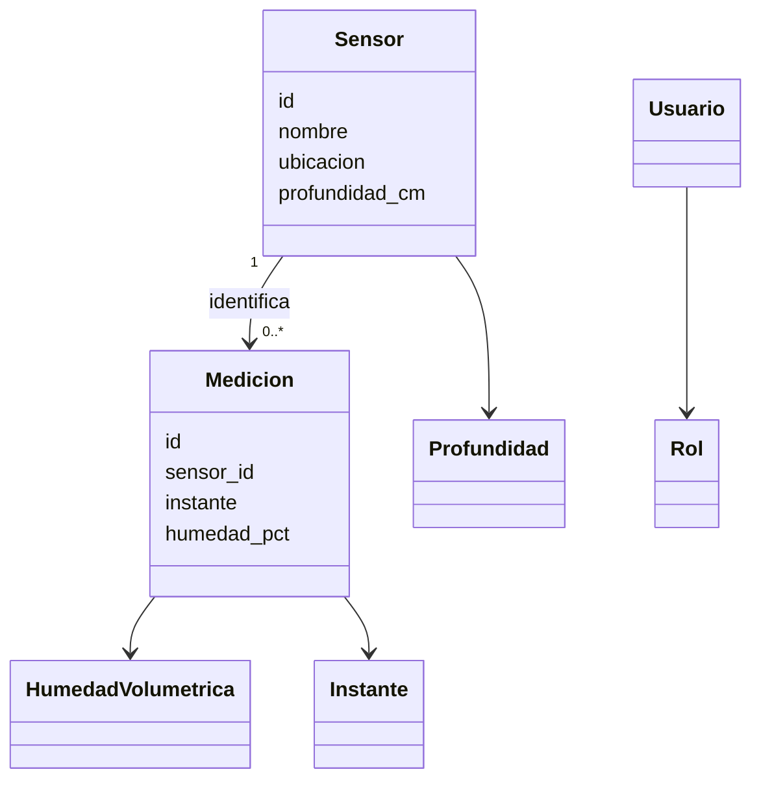
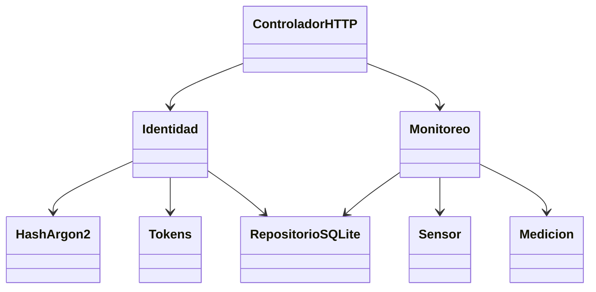

# Proyecto de aula · Prototipo 1

**AgroDecide**

Universidad Nacional de Colombia · Sede Bogotá

Ingeniería de Sistemas y Computación · Ingeniería de Software II (2016702) · 2026-II

| Campo | Información |
|---|---|
| Integrante 1 | Oscar Daniel Aguas Quiroz C.C 1102577573 |
| Integrante 2 | [Nombre y documento por confirmar] |
| Integrante 3 | [Nombre y documento por confirmar] |
| Integrante 4 | [Nombre y documento por confirmar] |
| Integrante 5 | [Nombre y documento, si aplica] |
| Grupo | [Por confirmar] |
| Fecha establecida por la guía | 11 de noviembre de 2026 |
| Fecha efectiva de entrega | [Por confirmar] |

## Resumen ejecutivo

AgroDecide propone una aplicación web local para agricultores colombianos y quienes administran sus datos. Reúne mediciones de sensores, series agrícolas públicas y estimaciones con procedencia explícita para apoyar decisiones de riego y comercialización. La predicción principal estima la humedad del mismo sensor y profundidad 24 horas después de la consulta a partir de las últimas 24 horas. La secundaria estima el siguiente precio mayorista observado para un producto y un mercado específicos. Se proyecta un asistente en español con Ollama, recuperación documental y consultas controladas. El Prototipo 1 entrega una API REST local en Python con SQLite, JWT y Argon2id para el acceso por roles y el CRUD de sensores y mediciones, junto con wireframes adaptables. Se ejecutaron dos evaluaciones retrospectivas reproducibles. La serie de humedad requiere aclarar el origen de parte de las filas antes de usar el resultado en campo. El asistente y la publicación de pronósticos quedan como diseño. Los anexos presentan el protocolo, los resultados y sus límites.

## 1. Requisitos

### 1(a). Visión del producto

Los agricultores colombianos deben reunir mediciones de campo e información de mercado procedente de fuentes con escalas y frecuencias distintas antes de decidir cuándo revisar el riego o la comercialización. AgroDecide ofrece a productores y administradores una aplicación web de ejecución local para registrar y consultar observaciones de humedad, interpretar tendencias agrícolas y acceder a estimaciones trazables de humedad y precios. El valor reside en relacionar cada resultado con su sensor, profundidad, fecha o mercado, de modo que el usuario pueda juzgar la pertinencia de la evidencia antes de actuar.

### 1(b). Roles y permisos

El registro público crea cuentas de agricultor. El operador local provisiona administradores por CLI. La autenticación comprueba la identidad por credenciales y JWT. La autorización comprueba el rol para la operación solicitada.

| Función | Sin sesión | Agricultor | Administrador |
|---|:---:|:---:|:---:|
| Registrarse como agricultor e iniciar sesión | Sí | Sí | Sí |
| Consultar perfil agrícola | — | Sí | — |
| Leer sensores y mediciones | — | Sí | Sí |
| Crear, editar y eliminar sensores y mediciones | — | — | Sí |
| Consultar pronósticos, EVA y asistente (diseño) | — | Sí | — |

El alcance inicial corresponde a una instalación local con un catálogo compartido. La separación por finca requerirá autorización por recurso y un cambio explícito del modelo de datos antes de operar con organizaciones distintas.

### 1(c). Historias de usuario

| ID | Historia |
|---|---|
| HU-01 | Como agricultor, quiero crear una cuenta, para consultar los datos de la instalación. |
| HU-02 | Como usuario, quiero iniciar sesión, para acceder a las tareas autorizadas de mi rol. |
| HU-03 | Como agricultor, quiero consultar el perfil de mi sesión, para confirmar qué cuenta estoy usando. |
| HU-04 | Como agricultor, quiero identificar el sensor, la ubicación y la profundidad, para seleccionar una serie pertinente. |
| HU-05 | Como agricultor, quiero consultar las mediciones de un sensor, para reconocer cambios de humedad en su ubicación. |
| HU-06 | Como administrador, quiero crear, consultar, editar y eliminar sensores, para mantener el inventario de puntos de medición. |
| HU-07 | Como administrador, quiero crear, consultar, corregir y retirar mediciones, para mantener un historial utilizable. |
| HU-08 | Como agricultor, quiero consultar la estimación de humedad a 24 horas, para decidir cuándo volver a revisar el estado del suelo. |
| HU-09 | Como agricultor, quiero consultar producción histórica por cultivo y municipio, para conocer el contexto productivo de mi zona. |
| HU-10 | Como agricultor, quiero consultar la estimación del siguiente precio observado de mi variedad de tomate en un mercado, para preparar la venta. |
| HU-11 | Como agricultor, quiero preguntar en español por el significado de una medición o predicción, para interpretar la información disponible. |

**INVEST.** Cada historia tiene un resultado de usuario verificable con datos de prueba preexistentes o preparados por separado (*Independent*, *Testable*). La interfaz y el algoritmo admiten ajustes sin modificar el resultado esperado (*Negotiable*). Las frases explicitan el beneficio (*Valuable*). El alcance queda delimitado por un recurso, una vista o una consulta de solo lectura y recibe una estimación relativa (*Estimable*, *Small*). HU-06 y HU-07 se desarrollan y prueban por operación, manteniendo la misma finalidad de administración.

### 1(d). Criterios de aceptación

Los criterios se vinculan a las historias por su identificador. Los estados HTTP corresponden al backend y los estados de interfaz describen el cliente diseñado.

#### HU-01 · Registro

- Dado un correo válido y disponible, cuando registro una contraseña conforme al contrato, entonces se crea la cuenta de agricultor y la API devuelve 201.
- Dado un correo ya registrado, cuando repito el registro, entonces recibo 409 y se conserva una única cuenta.

#### HU-02 · Inicio de sesión

- Dadas credenciales vigentes, cuando inicio sesión, entonces recibo 200 y un token con 900 segundos de vigencia.
- Dada una contraseña incorrecta, cuando inicio sesión, entonces recibo 401 y el formulario conserva únicamente el correo.

#### HU-03 · Perfil agrícola

- Dado un JWT de agricultor, cuando consulto el perfil, entonces recibo 200 con la identidad de esa cuenta.
- Dado un JWT de administrador, cuando solicito el perfil agrícola, entonces recibo 403.

#### HU-04 · Catálogo de sensores

- Dado un sensor registrado, cuando consulto el catálogo, entonces recibo 200 y puedo identificarlo por nombre, ubicación y profundidad en cm.
- Dado un identificador inexistente, cuando consulto su detalle con sesión válida, entonces recibo 404.

#### HU-05 · Historial de humedad

- Dadas mediciones de dos sensores, cuando selecciono uno, entonces el cliente muestra solo sus registros con fecha, hora y humedad volumétrica en porcentaje.
- Dado un sensor sin registros, cuando abro el historial, entonces el cliente muestra un estado vacío con el sensor seleccionado.

#### HU-06 · Gestión de sensores

- Dado un JWT de administrador, cuando creo un sensor válido y sin mediciones, luego consulto, edito y elimino el registro, entonces obtengo en orden 201, 200, 200 y 204.
- Dado un JWT de agricultor, cuando intento crear un sensor válido, entonces recibo 403.

#### HU-07 · Gestión de mediciones

- Dado un sensor registrado, cuando creo una lectura válida y luego la consulto, actualizo y elimino, entonces obtengo 201, 200, 200 y 204.
- Dada una humedad superior al 100 %, cuando solicito registrar la lectura, entonces recibo 400 y el total de registros no cambia.

#### HU-08 · Predicción de humedad

- Dada una predicción publicada, cuando selecciono el sensor, entonces veo humedad estimada en %, instante objetivo exactamente 24 horas después del corte, versión del modelo y procedencia.
- Dada una ventana con cobertura inferior al umbral fijado para el modelo, cuando consulto la estimación, entonces veo un aviso de información insuficiente y el historial permanece disponible.

#### HU-09 · Consulta EVA

- Dado un filtro con coincidencias, cuando selecciono municipio, cultivo y período, entonces veo los registros de EVA, sus unidades, período y fuente.
- Dado un filtro válido sin coincidencias, cuando consulto, entonces veo un estado sin registros y puedo modificar el filtro.

#### HU-10 · Precio mayorista

- Dada una serie con predicción publicada, cuando selecciono su clave, entonces veo unidad, corte, frecuencia observada y pronóstico de la siguiente observación.
- Dada una combinación producto–mercado sin predicción, cuando consulto, entonces veo el historial disponible y un aviso de pronóstico ausente.

#### HU-11 · Asistente con fuentes

- Dado un resultado recuperable, cuando pregunto por su procedencia, entonces el asistente devuelve en español el sensor o serie, el corte y una referencia al registro o documento.
- Dada una consulta sobre datos ausentes, cuando pregunto por ellos, entonces el asistente indica que carece de evidencia suficiente.

### 1(e). Story map

| Versión | Acceder | Reconocer el cultivo | Mantener datos | Contextualizar decisiones | Interpretar en español |
|---|---|---|---|---|---|
| Prototipo 1 · MVP | Crear cuenta HU-01, autenticarse HU-02, confirmar perfil HU-03 | Identificar sensor HU-04, consultar historial HU-05 | Gestionar sensores HU-06 y mediciones HU-07 | — | — |
| Incremento del semestre · MVP | — | Consultar estimación a 24 h HU-08 | — | Consultar EVA HU-09 y siguiente precio HU-10 | Explicar un resultado con referencia HU-11 |

El MVP del semestre incluye HU-01 a HU-11. El incremento acota cada pronóstico a un sensor o una serie seleccionada, y el asistente a consultas de solo lectura. Compatibilidad entre fincas, automatización de riego, alertas y publicación en tiendas se difieren. La disponibilidad de predicciones depende de completar la evaluación cronológica y registrar las limitaciones de cada modelo.

### 1(f). Estimación y GitHub Projects

Estimación preliminar en escala Fibonacci de Planning Poker. Un valor de 2 representa una vista o consulta sencilla, 3 añade validaciones o integración, 5 combina flujo y persistencia, y 8 cubre un incremento con incertidumbre de datos o evaluación acotada. El equipo debe contrastar sus votos y resolver divergencias antes de fijar la capacidad de la iteración.

| ID | Historia | Story points | Prioridad | Versión | Estado |
|---|---|---:|---|---|---|
| HU-01 | Registro | 3 | Alta | P1 | API |
| HU-02 | Inicio de sesión | 3 | Alta | P1 | API |
| HU-03 | Perfil agrícola | 2 | Media | P1 | API |
| HU-04 | Catálogo | 2 | Alta | P1 | API |
| HU-05 | Historial | 3 | Alta | P1 | API de lectura y wireframe |
| HU-06 | Gestión de sensores | 5 | Alta | P1 | API |
| HU-07 | Gestión de mediciones | 5 | Alta | P1 | API |
| HU-08 | Humedad a 24 h | 8 | Alta | MVP semestre | Investigación |
| HU-09 | Consulta EVA | 5 | Media | MVP semestre | Diseño |
| HU-10 | Precio mayorista | 8 | Media | MVP semestre | Investigación |
| HU-11 | Asistente con fuentes | 8 | Media | MVP semestre | Diseño |

El repositorio indicado es [JuanDiegoMT/Ingesof2](https://github.com/JuanDiegoMT/Ingesof2). Para publicar el tablero se requiere crear un issue por historia, cargar los criterios, configurar campos de puntos, prioridad, versión y estado, y enlazar el tablero en el README con el acceso acordado por el equipo.

## 2. Experiencia de usuario

### 2(a). Wireframes web y móvil

El [archivo fuente HTML](wireframes.html) incluye 15 pantallas o estados con versiones de escritorio (referencia de 864 px para el panel visible) y móvil (390 px). Las listas pasan a tarjetas en pantalla estrecha y los controles principales conservan su etiqueta textual. Los gráficos son áreas reservadas sin observaciones simuladas. Se verificaron las 30 variantes y los 15 destinos del índice por parseo HTML. Una [captura de Firefox](evidencias/wireframes-acceso.png) muestra el acceso en escritorio y móvil. Está pendiente publicar un enlace de solo lectura y verificarlo con una cuenta ajena al equipo.

| Pantalla y rol | Objetivo, componentes, datos y acciones | Validación y estados |
| --- | --- | --- |
| Inicio de sesión · visitante | Introducir correo y contraseña, iniciar sesión o abrir el registro. | Correo válido, contraseña obligatoria, credenciales rechazadas o servicio inaccesible. |
| Registro · visitante | Crear una cuenta de agricultor con correo y contraseña y volver al acceso. | Reglas de formato y contraseña, corrección de campos y correo duplicado. |
| Panel · agricultor o administrador | Lanzar la consulta prioritaria o la gestión del catálogo y salir de la sesión. Cada rol ve las acciones habilitadas. | Una sesión expirada devuelve al ingreso. Una ruta vedada ofrece regreso al panel. |
| Perfil · agricultor | Consultar identificador de cuenta, correo y rol. | Mostrar el acceso cuando el token haya expirado. |
| Catálogo · agricultor | Elegir un sensor identificado por nombre, ubicación y profundidad. Abrir el historial desde la colección paginada. | Mostrar un aviso para catálogo vacío o sensor retirado. |
| Historial · agricultor | Filtrar por sensor e intervalo y consultar serie, ubicación, profundidad y unidad. | Intervalo ordenado y sensor válido. Un intervalo vacío muestra un mensaje de ausencia de datos. |
| Pronóstico de humedad · agricultor | Elegir sensor y consultar última medición, instante de corte, humedad estimada a t + 24 h y versión de modelo. | Identificar cobertura insuficiente de la ventana de 24 h o ausencia de pronóstico. |
| Consulta EVA · agricultor | Filtrar por municipio, cultivo y período y consultar área, producción y fuente. | Combinación válida y unidades visibles. Una búsqueda vacía permite modificar los filtros. |
| Pronóstico de precio · agricultor | Elegir variedad de tomate y mercado, consultar último precio disponible y estimación para el siguiente período de SIPSA. | Serie disponible para la combinación. La interfaz informa período y unidad de origen y distingue ausencia de serie de un error de conexión. |
| Asistente · agricultor | Preguntar en español, leer la respuesta y revisar las fuentes o períodos citados. | Pregunta obligatoria. El usuario ve si existe evidencia insuficiente o si el servicio está caído. |
| Lista y detalle de sensores · administrador | Consultar identificador lógico, ubicación y profundidad, y abrir alta, edición o confirmación de baja. | Confirmar baja, indicar sensor inexistente y explicar un conflicto de integridad. |
| Formulario de sensor · administrador | Crear o editar metadatos y regresar al listado. | Campos obligatorios y profundidad válida. Los errores mantienen los valores ingresados. |
| Lista y detalle de mediciones · administrador | Filtrar por sensor, consultar mediciones, abrir alta o edición y confirmar baja. | Validar sensor, mostrar lista vacía y solicitar confirmación de baja. |
| Formulario de medición · administrador | Registrar o corregir el sensor, instante y valor de humedad. | Sensor existente, instante RFC 3339 con zona horaria y humedad volumétrica entre 0 y 100 %. Informar duplicados cuando corresponda. |
| Acceso y servicio · todos | Mostrar una acción de recuperación adecuada al estado. | En 401 se ofrece iniciar sesión, en 403 volver al panel y ante un fallo transitorio reintentar. |

Las vistas describen el cliente diseñado. La API permite filtrar las mediciones por sensor. La selección de intervalo y la presentación pertenecen al cliente diseñado. La sección 4 identifica las operaciones del backend que ya pueden verificarse.

### 2(b). Flujo de navegación

El recorrido principal parte del acceso. El agricultor abre el catálogo, selecciona el sensor y verifica la unidad y la profundidad en el historial y abre su pronóstico a 24 h. La ausencia de datos devuelve a los filtros con una explicación. El administrador accede desde su panel a las listas y formularios de ambos recursos. Ocultar opciones en la interfaz facilita la navegación y el backend aplica las restricciones de cada operación.



### 2(c). Modelo de cliente

Se elige una aplicación web adaptable con un solo cliente y un backend local. La interfaz se abre en el navegador del equipo servidor o en un móvil de la red autorizada. Se conserva una base de código y un proceso de despliegue. Los cálculos y el modelo de lenguaje se ejecutan en el servidor, lo que reduce los requisitos del móvil. Un modo PWA instalable podría incorporarse si la operación en campo exige consulta sin conexión y se define qué información almacenar y cómo sincronizarla. En el MVP, las consultas necesitan llegar al servidor.

Un cliente híbrido añadiría empaquetado y pruebas por sistema operativo a cambio de acceso mediante un contenedor a funciones del dispositivo. Un cliente multiplataforma facilitaría el diseño con componentes móviles compartidos, con compilación y distribución propias. La opción nativa se justificaría si el teléfono debiera capturar datos en segundo plano o controlar sensores directamente. Como la captura y la inferencia quedan en el entorno servidor, las funciones previstas se cubren desde el navegador con diseño adaptable.

## 3. Diseño de la solución

### 3(a). Arquitectura



Los trazos discontinuos representan el diseño de integración. El cliente se entrega como wireframes. Se propone organizar cada vista en componentes de presentación, estado de consulta y adaptador HTTP, de forma que web y móvil compartan navegación y contrato. La vista móvil corresponde al mismo cliente adaptable servido al navegador. El backend se organiza como monolito modular con separación de responsabilidades inspirada en puertos y adaptadores. El transporte interpreta HTTP y aplica controles transversales, la aplicación coordina operaciones, el dominio expresa reglas, y SQLite implementa persistencia relacional embebida. El despliegue local evita coordinar procesos distribuidos para cada CRUD. SQLite reduce la operación de una instancia de curso y exige revisar capacidad de escritura antes de aumentar la concurrencia.

El entrenamiento por lotes permite reproducir cortes y recalcular predicciones sin prolongar una petición web. Una predicción se publica con unidad, instante de corte y versión para consumo posterior. Ollama sería un proceso especializado de inferencia accesible solo desde el backend. El módulo de recuperación combina fuentes indexadas y consultas limitadas conforme al rol. Un fallo en la inferencia deja operativas las lecturas y escrituras ordinarias.

### 3(b). Modelo de dominio con DDD

| Término | Significado en AgroDecide |
|---|---|
| Sensor | Identidad del punto que origina observaciones. |
| Ubicación | Referencia del lugar de instalación del sensor. |
| Profundidad | Distancia en cm desde la superficie a la sonda. |
| Medición | Lectura de humedad para un sensor e instante concretos. |
| Humedad volumétrica | Proporción del volumen de agua respecto al volumen de suelo, expresada como porcentaje. |
| Instante de corte | Momento hasta el que el modelo puede observar datos. |
| Ventana histórica | Observaciones de las 24 h anteriores al corte, incluida la lectura del corte si existe. |
| Horizonte | Intervalo entre corte y objetivo. Para humedad son 24 h. |
| Persistencia | Predicción que conserva la última observación válida. |
| Serie mayorista | Secuencia identificada por producto, mercado, unidad y periodicidad. |
| Predicción publicada | Estimación disponible con clave de serie, corte, objetivo y versión. |
| Procedencia | Vínculo a la fuente, versión y transformaciones de un dato. |
| Evidencia documental | Fragmento recuperable con identificador y referencia a su fuente. |



Identidad posee cuenta y rol. Monitoreo posee sensores y lecturas, y publica su proyección de consulta. El contexto de mercado traduce categorías y periodicidades de SIPSA y conserva EVA como conjunto productivo independiente. Los módulos predictivos consumen series explícitas y publican estimaciones versionadas. La consulta asistida es consumidora y usa las mismas restricciones de lectura. Los enlaces discontinuos corresponden a integraciones propuestas dentro de la instalación.

**Agregado propuesto «Serie de humedad».** La raíz conceptual es Sensor. Cada Medición es una entidad identificada dentro del contexto de monitoreo. Profundidad, Instante y HumedadVolumétrica se modelan como objetos de valor con igualdad por magnitud o instante normalizado. Las operaciones son asignar ubicación y profundidad al registrar una sonda, incorporar una lectura, corregir una lectura y retirar una lectura o un sensor. Sus invariantes son pertenencia a un sensor existente, humedad entre 0 y 100 %, instante con zona y unicidad por sensor e instante. Se propone tratar el traslado o cambio de profundidad como una nueva serie si ya hay historial. El CRUD persiste ambos recursos por separado. El diseño del agregado especifica las reglas que deben conservarse entre operaciones sin cargar todo el historial en memoria.

### 3(c). Clases y SOLID

Modelo conceptual de dominio, incluidos los objetos de valor propuestos.



Modelo de aplicación con los nombres existentes y las dependencias que recibe cada colaborador.



| Principio | Aplicación y efecto |
|---|---|
| Responsabilidad única | Transporte HTTP transforma solicitudes en respuestas. Los casos de uso coordinan operaciones y la persistencia ejecuta el acceso a SQLite. Un cambio de representación JSON queda fuera del SQL. |
| Inversión de dependencias | `Identidad` y `Monitoreo` reciben colaboradores en el constructor y operan sobre los métodos que requieren, de modo que una prueba puede inyectar otras implementaciones compatibles. Los puertos explícitos de almacenamiento quedan como decisión de diseño. |
| Abierto/cerrado | La selección del algoritmo de predicción mediante Strategy se propone para comparar candidatos sin cambiar el contrato de publicación. |
| Segregación de interfaces | El diseño de RAG ofrece consultas parametrizadas de lectura. El asistente carece de métodos de escritura aunque el repositorio de administración los ofrezca. |

### 3(d). Patrones GoF

| Patrón | Aplicación propuesta en AgroDecide |
|---|---|
| **Strategy** · comportamiento | El evaluador necesita ejecutar la misma partición y métricas para persistencia y un candidato. `EvaluadorCronologico` llama al contrato `EstrategiaPronostico`; `Persistencia` y `RegresorRezagos` devuelven valores en las mismas unidades. El cambio de algoritmo conserva fechas, datos y criterio de comparación. |
| **Adapter** · estructural | Las fuentes de mercado e IoT publican esquemas y unidades diferentes. `AdaptadorSIPSA` y `AdaptadorIoT` traducen sus formatos a puertos distintos, `FuentePrecios` y `FuenteMediciones`. Los consumidores reciben claves, unidades, tiempo y procedencia normalizados, mientras fallos de conversión quedan en la frontera. Se diseña un adaptador por formato sin suponer que los dos conjuntos comparten significado. |

### 3(e). Escenarios de calidad

| Fuente | Estímulo | Artefacto | Entorno | Respuesta | Medida |
|---|---|---|---|---|---|
| Agricultor autenticado | Envía una creación de sensor | Ruta de escritura y base | Instalación de prueba con JWT vigente | Deniega operación | 403 y 0 filas nuevas |
| Cliente web | Envía 20 lecturas concurrentes | Listado de mediciones | Equipo de sustentación, 1.000 filas de prueba, sin entrenamiento | Entrega colección válida | p95 ≤ 300 ms y 0 fallos en la serie |
| Agricultor | Pregunta por una predicción con Ollama detenido | Consulta asistida | Instalación local con API y SQLite activos | Informa indisponibilidad, mantiene lectura directa | Aviso en ≤ 5 s y GET de historial responde 200 |

La prueba de seguridad confirmó 403 y un listado idéntico antes y después de un intento de escritura con rol agricultor. Para desempeño, se propone una consulta indexada por sensor e instante con salida acotada. La verificación futura registrará hardware, datos y latencias de ejecuciones repetidas. Para disponibilidad, se propone un tiempo límite en inferencia y aislamiento del componente Ollama. La prueba futura detendrá el proceso de inferencia y medirá el aviso y la lectura en paralelo.

## 4. API segura (parte implementada)

### 4(a). OpenAPI 3

El contrato [OpenAPI](../openapi.yaml) describe identificación, perfil y las operaciones de sensores y mediciones bajo `/api/v1`. Declara esquemas de entrada y salida, ejemplos, errores JSON y seguridad HTTP `bearerAuth` de tipo bearer con formato JWT. El registro e inicio de sesión declaran acceso público. La especificación del Prototipo 1 cubre el backend disponible. Las operaciones de EVA, predicciones y asistente pertenecen al siguiente incremento. [Especificación OpenAPI 3.0.3](https://spec.openapis.org/oas/v3.0.3.html)

El contrato se puede descargar de la API local en `GET /openapi.yaml`. La prueba de integración verifica que el contenido publicado coincide con el archivo de la entrega. `openapi-spec-validator` 0.9.0 validó la especificación OpenAPI 3.0.3 con salida `openapi.yaml: OK`. La revisión independiente cotejó 13 operaciones de negocio en siete rutas, con dos operaciones públicas y once protegidas. Swagger Editor 4.14.8 procesó el YAML en Firefox local y reportó cero diagnósticos. Una copia de control sin `info.title` produjo un error estructural, lo que confirmó que la validación estaba activa. [Captura de Swagger Editor](evidencias/swagger-editor.png)

### 4(b). Backend con dos CRUD

Base `/api/v1`. El cuerpo completo de sensor es `{nombre, ubicacion, profundidad_cm}`; el de medición es `{sensor_id, instante, humedad_pct}`. El detalle y la escritura devuelven el objeto con su identificador.

| Operación | Sensores | Mediciones | Entrada y respuesta | Acceso |
|---|---|---|---|---|
| Crear | POST `/sensores` | POST `/mediciones` | JSON del recurso → 201 | Administrador |
| Listar | GET `/sensores` | GET `/mediciones` | Paginación por `limite` y `desplazamiento`. Filtro `sensor_id` solo en mediciones → 200, colección | Ambos |
| Obtener | GET `/sensores/{id}` | GET `/mediciones/{id}` | ID entero positivo → 200 o 404 | Ambos |
| Reemplazar | PUT `/sensores/{id}` | PUT `/mediciones/{id}` | ID y JSON completo → 200 o 404 | Administrador |
| Eliminar | DELETE `/sensores/{id}` | DELETE `/mediciones/{id}` | ID → 204 sin cuerpo o 404 | Administrador |

El dominio valida nombre, ubicación, profundidad entre 0,1 y 1.000 cm, fecha con zona y humedad en [0, 100]. La persistencia garantiza integridad referencial y unicidad por sensor e instante normalizado. Corresponde 409 al intentar duplicar una lectura o eliminar un sensor con lecturas. Un sensor referenciado inexistente produce 404. El controlador asigna parámetros y estados HTTP, `Monitoreo` ejecuta el caso de uso con `Sensor` o `Medicion`, y `RepositorioSQLite` aplica las restricciones en transacciones. La separación se observa en [dominio](../agrodecide/dominio.py), [aplicación](../agrodecide/aplicacion.py) y [persistencia](../agrodecide/repositorio.py).

### 4(c). Autenticación JWT

`POST /api/v1/auth/registro` valida credenciales, calcula un hash Argon2id con sal y persiste el rol agrícola. `POST /api/v1/auth/login` valida la contraseña contra el hash almacenado y emite un access token firmado con HS256 por 900 segundos. En solicitudes protegidas el cliente envía `Authorization: Bearer <token>`. El backend valida firma y vigencia, y resuelve la identidad y el rol a partir de la cuenta almacenada. La cuenta administrativa se provisiona desde la CLI local. [Código de seguridad](../agrodecide/seguridad.py) · [JWT, RFC 7519](https://www.rfc-editor.org/rfc/rfc7519) · [Argon2, RFC 9106](https://www.rfc-editor.org/rfc/rfc9106)

Ejemplo ficticio para ambos cuerpos de solicitud y sus respectivas respuestas satisfactorias. El valor del token está abreviado.

```text
POST /api/v1/auth/registro    {"correo":"persona@example.test","contrasena":"frase-demo-local-2026"}
201                           {"id":1,"correo":"persona@example.test","rol":"agricultor"}
POST /api/v1/auth/login       {"correo":"persona@example.test","contrasena":"frase-demo-local-2026"}
200                           {"access_token":"<JWT>","token_type":"Bearer","expires_in":900}
```

### 4(d). Autorización por roles

| Operación | Sin token válido | Agricultor | Administrador |
|---|---|---|---|
| GET `/api/v1/mi-perfil` | 401 | 200 | 403 |
| GET `/api/v1/sensores`, `/api/v1/mediciones` | 401 | 200 | 200 |
| POST `/api/v1/sensores` con cuerpo válido | 401 | 403 | 201 |
| PUT y DELETE por ID existente, reglas satisfechas | 401 | 403 | 200 o 204 |

401 indica que el servidor carece de una identidad autenticada para la solicitud. 403 indica que el servidor reconoció al usuario y su rol carece del permiso. Los dos roles tienen una operación exclusiva. Ocultar un botón de escritura en el navegador facilita la navegación. El backend hace cumplir la decisión de acceso.

### 4(e). Buenas prácticas de seguridad

La clave de firma se suministra por el entorno. La ruta de SQLite se configura de la misma forma y la base local se protege mediante permisos del sistema de archivos. SQLite embebido carece de credenciales de red. Los valores de datos se vinculan como parámetros SQL. Las validaciones de dominio limitan campos, longitudes, tipos y rangos, mientras la base refuerza referencias y unicidad. El error usa `{"error":{"codigo":"…","mensaje":"…"}}`; las respuestas genéricas a fallos internos preservan el detalle en el servidor. El servidor restringe CORS a orígenes expresamente configurados. Argon2id y expiración reducen el impacto de exposición de la base o de una sesión, respectivamente.

La producción requiere validar protección del archivo SQLite y copias, configuración CORS del origen final, gestión operativa de la clave y límites de intentos de login en el perímetro. El JWT debe mantenerse fuera de logs y persistencia del navegador en el cliente previsto. La prueba de laboratorio no acredita el endurecimiento del entorno productivo.

### 4(f). HTTPS

Se acredita ejecución local, con TLS de despliegue pendiente. En el entorno final, un proxy Caddy o Nginx terminaría TLS 1.2/1.3 con certificado confiable para el nombre del servicio. El puerto de la aplicación quedaría accesible solo por loopback o red privada del proxy. Se configura HTTPS como único canal de servicio y se verifica que una petición HTTP directa no llega al backend. La renovación automática debe verificarse y la aplicación debe mantener una lista CORS coherente con el origen HTTPS. Para una instalación de laboratorio en LAN se necesita que los dispositivos confíen en la CA local o dispongan de un certificado público válido.

### 4(g). Postman y pruebas

La [colección exportada](../postman/AgroDecide.postman_collection.json) encadena registro, login de ambos roles, escrituras y lecturas de los dos recursos y su eliminación. Guarda identificadores y tokens en variables de ejecución y comprueba códigos, cuerpos y estados de error. Usa una base temporal y un administrador de prueba.

| Prueba | Resultado esperado | Resultado observado | Estado |
|---|---|---|---|
| Registro, login y perfil agrícola | 201, 200 con JWT y 200 con perfil | 201, 200 y 200 | Aprobada |
| CRUD de sensores | 201, 200 en lecturas y actualización, 204 y 404 posterior | Códigos esperados en Newman | Aprobada |
| CRUD de mediciones | 201, 200 en lecturas y actualización, 204 y 404 posterior | Códigos esperados en Newman | Aprobada |
| Petición protegida sin token | 401 | 401 y esquema de error | Aprobada |
| Escritura con rol agricultor y perfil con rol administrador | 403 en ambos | 403 en ambos | Aprobada |
| Profundidad inválida | 400 | 400 y esquema de error | Aprobada |
| Duplicado o sensor con mediciones | 409 | 409 en ambos | Aprobada |

**Ejecución automatizada.** Newman 6.2.3 ejecutó una iteración de la colección por HTTP en loopback. Registró 22 solicitudes, 22 scripts, 40 aserciones y 0 fallos. La ejecución en la interfaz gráfica de Postman queda pendiente. Una comprobación HTTP adicional verificó 5 de 5 respuestas esperadas. La suite `python3 -m unittest discover -s tests -v` aprobó 6 de 6 pruebas WSGI con SQLite temporal. Además de CRUD, comprobó Argon2id, expiración del JWT, ausencia de escrituras ante 403, humedad fuera de rango, CORS y publicación del contrato.

### 4(h). API externa opcional

Bonificación pendiente. Una consulta acotada de datos EVA mediante la API de Datos Abiertos sería útil para actualizar registros por municipio y cultivo. Se propone un adaptador servidor con filtros permitidos, caché por consulta, timeout y respuesta de fuente indisponible que conserve el último lote verificado. Un token de aplicación, si se requiere, se suministraría por entorno. Las publicaciones SIPSA descargadas para evaluación constituyen insumos por lotes. La bonificación exige una integración mediante adaptador operativo.

## 5. Repositorio y trabajo en equipo

### 5(a). Repositorio GitHub

El destino de entrega es [JuanDiegoMT/Ingesof2](https://github.com/JuanDiegoMT/Ingesof2). La carpeta de trabajo inicial carecía de historial Git. GitHub identifica el repositorio como público. La guía pide acceso para `sevargasp@unal.edu.co`, disponible mediante el enlace público una vez publicados los archivos.

### 5(b). README

El [README](../README.md) reúne la descripción, tecnologías, ejecución local, configuración, enlace a wireframes y contrato, y pruebas. Se siguió el procedimiento en una base descartable y se comprobó la creación del administrador, el arranque local y la publicación del contrato por HTTP. Las identidades del equipo y el enlace al tablero dependen de confirmación. [.env.example](../.env.example)

### 5(c). Ramas, commits y pull requests

El historial, los aportes individuales y las revisiones de pull requests quedan sin evidencia en la carpeta suministrada. La estrategia propuesta utiliza ramas por historia, commits descriptivos que refieran su identificador y pull requests revisadas por otro integrante. La revisión debe verificar criterios de aceptación y adjuntar salida de pruebas antes de integrar a la rama principal.

### 5(d). Exclusiones y secretos

El [.gitignore](../.gitignore) excluye bases de trabajo, cachés y archivos de configuración local. Se conserva una plantilla de entorno con valores de ejemplo. La revisión local de archivos buscó configuraciones reales, bases, llaves privadas y patrones comunes de tokens. No se encontraron coincidencias. La auditoría histórica requiere el repositorio real y sus referencias. El estado de los archivos presentes se revisa por separado y los valores de credenciales quedan fuera del informe.

## 6. Documento y sustentación

### 6(a). Estructura del documento

El cuerpo principal sigue la numeración de la guía. Incluye portada, visión, requisitos, experiencia de usuario, diseño, seguridad, proceso de equipo y sustentación. La evaluación y lista de verificación aparecen antes de los anexos. La metodología, evidencia técnica, decisiones y riesgos quedan después del corte de anexos para exportar el cuerpo por separado. Se recomienda A4, tipografía de 10,5 a 11 puntos y orientación vertical, con los diagramas Mermaid convertidos a gráficos para la copia en PDF. La decisión de concentrar el prototipo en el monitoreo local reduce dependencias. Sus riesgos principales son la continuidad de las series, la escala del almacenamiento local y la trazabilidad de las predicciones. El Prototipo 2 debe incorporar el cliente y evaluar una sonda observada antes de publicar pronósticos. Una exportación de prueba en A4 ocupó 14 páginas, con portada y diagramas y antes del corte de anexos.

### 6(b). Sustentación de 15 minutos

| Tiempo | Desarrollo | Evidencia preparada |
|---|---|---|
| 0:00–5:00 | Visión, roles, historias del MVP, recorrido de humedad, arquitectura y agregado | Story map, wireframe y diagramas de §3 |
| 5:00–10:00 | Registrar agricultor, iniciar sesión, consultar recurso protegido, intentar escritura con ese token y mostrar 403, abrir documentación API | Colección, servidor local, cuenta administrativa preparada y OpenAPI |
| 10:00–15:00 | Preguntas técnicas a cualquier integrante | Respuestas siguientes y anexos |

La asistencia de todos los integrantes es obligatoria y la calificación de la sustentación es individual. Conviene preparar una base de demostración separada con una sonda y una lectura, generar credenciales exclusivas de ese entorno y comprobar previamente CORS y el puerto local.

| Pregunta | Respuesta de sustentación |
|---|---|
| ¿Qué protege el agregado? | La lectura pertenece a una sonda existente y sigue una unidad y un instante inequívocos. SQLite protege unicidad y referencialidad entre escrituras. |
| ¿Dónde aporta SOLID? | La representación HTTP se cambia en transporte. La persistencia queda en el repositorio que recibe el caso de uso. |
| ¿Cómo se distingue 401 de 403? | Se valida primero el JWT y se identifica la cuenta. La falta de identidad produce 401. El rol autenticado que carece de acceso obtiene 403. |
| ¿Por qué PUT y DELETE? | PUT reemplaza la representación identificada. DELETE elimina el recurso y responde sin cuerpo cuando la regla de integridad lo permite. |
| ¿Qué aportan GoF y el monolito modular? | Strategy conserva el contrato al comparar modelos. Adapter normaliza fuentes. El monolito mantiene un despliegue local simple con límites definidos entre módulos. |
| ¿Cómo evita fuga el predictor? | La entrada termina en el corte, la etiqueta pertenece al futuro y las particiones se ordenan por los cortes de disponibilidad de etiquetas. Las transformaciones se ajustan dentro del entrenamiento. |
| ¿Cómo se interpreta el piloto SIPSA? | Los resultados pertenecen a esa serie semanal y período. La comparación de MAE y RMSE ayuda a distinguir error típico y sensibilidad a errores grandes. |

## 7. Criterios de evaluación

| Criterio | Peso | Requisitos | Evidencia | Estado | Pendientes |
|---|---:|---|---|---|---|
| Requisitos | 20 % | INVEST, criterios, MVP y estimación | §1 | Parcial | Confirmar Planning Poker y publicar tablero |
| Experiencia de usuario | 10 % | Wireframes web y móvil, recorrido y cliente | §2 | Parcial | URL de solo lectura |
| Diseño | 25 % | Arquitectura, DDD, SOLID, GoF y calidad | §3 | Documentado | Validar metas de desempeño y disponibilidad |
| API segura | 30 % | OpenAPI, CRUD, JWT, roles y pruebas | §4 y anexo C | Verificado para P1 | Despliegue TLS, sesión gráfica de Postman y operaciones futuras del MVP |
| Repositorio y proceso | 5 % | README, acceso, ramas e historial | §5 | Parcial | Integrantes, revisiones y auditoría histórica |
| Sustentación | 10 % | Demostración y preguntas | §6 | Preparación documentada | Ensayo y sustentación con el equipo |

La rúbrica se expresa sobre 5,0 en la guía y sus pesos suman 100 %. El estado de evidencia de esta tabla carece de equivalencia con una nota oficial.

## 8. Lista de verificación

| Elemento de la guía | Estado | Evidencia o acción |
|---|---|---|
| Diez o más historias, cada una con dos o más criterios Given–When–Then | Verificado | 11 historias y 22 criterios en §1(c–d) |
| Story map con MVP marcado y tablero de GitHub Projects actualizado | Parcial | §1(e–f), falta tablero verificable |
| Wireframes web y móvil con enlace de solo lectura | Parcial | §2 y fuente local, falta enlace publicado |
| Diagramas de componentes y clases; glosario, bounded contexts y al menos un agregado | Verificado | §3(a–c), artefactos de diseño |
| Dos patrones GoF y tres escenarios de calidad documentados | Verificado | §3(d–e), documentación de diseño |
| `openapi.yaml` sin errores en Swagger Editor | Verificado | §4(a), cero diagnósticos en Swagger Editor local |
| Login JWT, dos roles, 401 y 403 funcionando, contraseñas con hash | Verificado | §4(c–g) |
| Ningún secreto en el repositorio, incluido historial | No verificable | §5(d), falta historial |
| Colección de Postman exportada y todas sus pruebas en verde | Verificado | §4(g), 40 aserciones aprobadas. Interfaz gráfica de Postman pendiente |
| README con ejecución reproducible sin ayuda | Verificado | §5(b), arranque por CLI y descarga del contrato por HTTP |

## Anexo A. Metodología de aprendizaje automático

### A.1. Procedencia y selección

| Fuente primaria | Tipo y contenido verificado | Uso y alcance |
|---|---|---|
| [MinAgricultura, EVA 2pnw-mmge](https://www.datos.gov.co/Agricultura-y-Desarrollo-Rural/Evaluaciones-Agropecuarias-Municipales-EVA/2pnw-mmge) | Agregados históricos municipales 2007–2018. Área sembrada y cosechada (ha), producción (t), rendimiento (t/ha), cultivo, período y código territorial. | Consulta histórica, separada de la telemetría. El catálogo distingue la fecha de actualización del metadato del período de los datos. |
| [Parodi-Camaño et al., Montería, DOI 10.17632/fn8h5h33ct.1](https://data.mendeley.com/datasets/fn8h5h33ct/1) | Telemetría observacional, cobertura enero–diciembre de 2025 en una grilla de 8760 horas esperadas, con pérdida de transmisiones explícita y diccionario. CC BY 4.0. | Fuente del ensayo retrospectivo. Se obtuvo el XLSX oficial, se verificó su SHA-256 y se inspeccionaron `IoT_Node_Observations`, `Data_Dictionary`, `Calibration_Log` y `Quality_Control_Rules`. La procedencia de los identificadores `-COMP-` requiere confirmación. |
| [Carriazo-Regino et al., Montería, DOI 10.17632/9g6mrrd8yc.1](https://data.mendeley.com/datasets/9g6mrrd8yc/1) | Serie observacional colombiana de 2025, con humedad por profundidad y registros horarios, diarios y mensuales. CC BY 4.0. | Candidato alternativo. Comparar fechas, identificadores y calibración antes de combinarlo con la publicación de Montería anterior o considerarlo una validación independiente. |
| [Kasera y Acharjee, riego en tomate, DOI 10.17632/33cngpcrmx.3](https://data.mendeley.com/datasets/33cngpcrmx/3) | Mediciones de un sistema de riego por goteo subterráneo. Sensor capacitivo SEN0193, otras variables ambientales y NPK. CSV preprocesado y normalizado según su ficha. CC BY 4.0. | Candidato complementario. Descartar como ensayo principal hasta verificar los registros originales, las unidades, el intervalo y si la normalización se ajustó antes de una división temporal. |
| [Adamo et al., DOI 10.17632/c837v6p8ph.2](https://data.mendeley.com/datasets/c837v6p8ph/2) | Ensayo observacional en Arnesano, Italia, febrero–septiembre de 2025. Cinco sectores, malla de diez minutos y variables de riego y meteorología, con archivos derivados que incluyen objetivos a 24 h. CC BY 4.0. | Candidato de comparación externa. Revisar el proceso de alineación e imputación y excluir actuadores posteriores al origen y reanálisis sin equivalente en producción. |
| [FAO, CROPWAT 8.0](https://www.fao.org/land-water/resources/tools/software/cropwat/en) | Herramienta de apoyo para calcular necesidades hídricas y programar riego con insumos edáficos, climáticos y del cultivo. | Referencia agronómica. Los resultados del programa son estimaciones condicionadas a sus insumos. |
| [DANE, SIPSA](https://www.dane.gov.co/index.php/servicios-al-ciudadano/servicios-informacion/sipsa) | Cotizaciones mayoristas publicadas diariamente, semanalmente y mensualmente. | En el piloto se transcribieron los precios medios del cuadro 2 de doce boletines semanales oficiales. Cada fila conserva URL, página y período. |

La ingestión propuesta conserva el archivo original, versión, fecha de recuperación, licencia y SHA-256. La capa normalizada registra columnas, unidades y motivos de rechazo. En IoT se valida el par sonda–profundidad y se mantiene la marca de calidad. En EVA se preserva el código territorial como cadena para conservar ceros iniciales y se distinguen cultivo, desagregación y período al resolver duplicados. En SIPSA se conserva el mercado, producto, unidad y momento de publicación. Si se habilita la consulta remota en un futuro, el [servicio SOAP de SIPSA](https://www.dane.gov.co/index.php/estadisticas-por-tema/agropecuario/sistema-de-informacion-de-precios-sipsa/servicio-web-para-consulta-de-la-base-de-datos-de-sipsa) se encapsulará en un adaptador de backend con límites de tiempo y caché con fecha y procedencia. Para esta entrega se usaron boletines.

### A.2. Humedad del suelo a 24 horas

Para una sonda *s* a profundidad *d*, sea *m(s,d,t)* la humedad volumétrica a la hora *t*. La entrada es la secuencia de horas en *(t−24 h, t]* de la misma sonda y profundidad. El objetivo es *y(t) = m(s,d,t+24 h)*. El procedimiento exige una lectura observada exactamente en la hora objetivo. El formato del piloto usa porcentaje volumétrico (% VWC), y MAE y RMSE se interpretan en puntos porcentuales de VWC. Si el archivo aporta una fracción volumétrica, se multiplica por cien después de verificar la unidad. Las cuentas crudas de un sensor requieren su calibración documentada.

El archivo original de Montería se adquirió en la versión 1 y contiene un nodo principal `NODE_001` (serie `SN-MON-PLT-2025-001`, parcela `PLOT_A01`, canal a 20 cm), con 8760 marcas horarias en 2025 según la zona `America/Bogota`. Se tomó la medición calibrada `soil_moisture_vwc_pct`, expresada en % VWC según el diccionario. El registro contiene veinte entradas de calibración de humedad aceptadas, con referencia gravimétrica. Para simular la disponibilidad remota, se excluyeron 438 observaciones sin recepción remota, aunque la hoja conserva mediciones locales, y 329 observaciones recibidas con calibración pendiente. El filtro físico 0–100 no excluyó lecturas adicionales. Se retuvieron 7993 mediciones. [Archivo XLSX publicado](https://data.mendeley.com/public-files/datasets/fn8h5h33ct/files/13250f26-d5bb-46cb-ad53-81abdfe3bc05/file_downloaded).

El [adaptador](../ml/preparar_monteria.py) valida la huella del archivo original. Conserva las 8760 horas y escribe un CSV con `timestamp,sensor_id,profundidad_cm,humedad_pct_vwc,recibido_en`, dejando vacías las lecturas excluidas. El evaluador convierte las fechas a UTC, exige marcas únicas en grilla horaria y contabiliza la disponibilidad real de cada lectura al origen usando `platform_received_timestamp`. Por ejemplo, una transmisión recibida segundos después de la hora programada queda fuera de la ventana de ese origen. Se requieren al menos 18 de las 24 posiciones observadas, una lectura disponible de antigüedad máxima de dos horas y etiqueta exactamente a 24 h.

La división se fija por tiempo transcurrido, aproximadamente 60/20/20. Para entrenamiento, tanto origen como etiqueta quedan antes del primer corte. Para validación quedan entre los cortes, y para prueba desde el segundo corte. Se excluyen los pares que cruzan los cortes. Las 24 h de entrada de un origen sí pueden usar mediciones pasadas de un bloque previo, que ya habrían estado disponibles en operación. Los dos modelos se comparan sobre los mismos orígenes. La persistencia toma la observación más reciente. La regresión univariada por mínimos cuadrados usa la media de las observaciones disponibles en 24 h y se ajusta solo en entrenamiento. Se acota su salida a [0, 100]. Es un candidato interpretable que atenúa ruido puntual. Si una validación posterior muestra error no lineal, se propone comparar Ridge y árboles potenciados con cobertura de ventana, dispersión y tendencia calculadas únicamente con mediciones disponibles al origen. La selección se hará en validación y se reservará el último bloque para la evaluación definitiva.

Se reportan MAE, RMSE, error medio con signo y R² cuando hay variación del objetivo. Una evaluación posterior comparará intervalos secos, cambios bruscos y distintos niveles de pérdida de lecturas. Si se estudian riegos, se usarán como estratos retrospectivos o como entradas solo cuando el dato estuviera disponible al emitir la predicción. Etiquetas interpoladas, ventanas centradas y meteorología futura observada introducirían fuga de información. En operación, se deberá conservar la fecha de recepción para aplicar el mismo control sobre los registros tardíos. Una evaluación sobre una sonda solo respalda esa sonda y profundidad. Para estudiar transferencia se requiere otro ensayo con sondas o sitios completos retenidos.

**Resultado de humedad sobre la tabla curada publicada.** Se usaron 4675 pares de entrenamiento, 1520 de validación y 1497 de prueba, correspondientes al 88,8 % de los 8665 orígenes elegibles tras la separación. Los cortes fueron 8 de agosto y 20 de octubre de 2025, ambos a las 04:00 UTC. Las métricas de error están en puntos porcentuales de VWC.

| Partición | Modelo | MAE | RMSE | Sesgo | R² |
|---|---|---:|---:|---:|---:|
| Validación | Persistencia | 0,665 | 0,844 | −0,008 | −0,883 |
| Validación | Regresión media 24 h | 0,516 | 0,664 | +0,171 | −0,166 |
| Prueba | Persistencia | 0,777 | 0,983 | +0,224 | 0,954 |
| Prueba | Regresión media 24 h | 0,760 | 0,937 | +0,471 | 0,958 |

La regresión sobre la media histórica redujo ambos errores en validación y prueba. Su mayor sobreestimación en prueba fue de 3,616 puntos para el objetivo del 9 de noviembre a las 00:00 de Bogotá. La regresión aumentó el sesgo positivo en el último bloque. El R² negativo en validación indica un error cuadrático mayor que el de la media constante de ese bloque. El fuerte cambio de R² entre particiones exige investigar diferencias de variabilidad y régimen temporal. Se conserva la regresión como candidata y la persistencia como referencia, con selección operativa pendiente de corroboración.

**Procedencia y sensibilidad.** La columna `packet_id_sent` contiene 7760 identificadores con la marca `-COMP-`. El diccionario consultado describe el campo sin definir la marca. Los 1000 identificadores restantes aparecen espaciados entre ocho y nueve horas, y 948 sobreviven a los filtros de calidad. Al excluir los identificadores marcados quedaron cero orígenes con cobertura suficiente y el programa terminó con código 2 antes de entrenar. Por ello, las métricas caracterizan un ensayo reproducible sobre la tabla curada, con procedencia de parte de sus valores pendiente de corroborar. La validación de campo requiere al autor explicar la marca y facilitar una serie horaria trazable, o incorporar una campaña independiente. Los pares solapados tampoco constituyen observaciones estadísticamente independientes.

### A.3. Precio mayorista de tomate chonto

Sea *p(k)* el precio medio mayorista publicado por DANE para la semana *k*. Se pronostica *p(k+1)* una vez publicado *p(k)*, para tomate chonto en Bazurto, Cartagena, en COP/kg. La muestra cubre doce semanas consecutivas entre el 2 de mayo y el 24 de julio de 2026. Se tomó la columna «Medio» del cuadro 2 y se normalizó el separador de miles a enteros. La primera predicción utiliza cinco semanas observadas. Después se expande el conjunto de entrenamiento una semana cada vez y se reestima AR(1) por mínimos cuadrados. Persistencia utiliza el último precio. Para series más amplias con semanas ausentes, se deberán marcar los huecos y definir la disponibilidad según fechas de publicación antes de comparar. El piloto exige semanas consecutivas.

| Modelo | Pronósticos evaluados | MAE (COP/kg) | RMSE (COP/kg) | Sesgo predicho − observado (COP/kg) |
|---|---:|---:|---:|---:|
| Persistencia | 7 | 554,86 | 590,93 | −2,29 |
| AR(1) expansivo | 7 | 491,26 | 747,87 | −261,39 |

AR(1) reduce el MAE en la muestra, pero subestima en 1713,06 COP/kg la subida del 12 de junio y su RMSE supera el de persistencia. Se conserva persistencia como base de referencia hasta validar con más años, incluyendo cambios de oferta. La muestra de siete orígenes impide inferir estabilidad a largo plazo, estacionalidad o desempeño en otros mercados. El precio mayorista se muestra como referencia comercial y puede diferir del precio recibido por el productor.

**Reproducción y registro de modelos.** Usar Python 3.11 o superior, con biblioteca estándar. Se ejecutó `python3 ml/evaluar.py precios` en Python 3.14.10. El [CSV SIPSA](../ml/sipsa_tomate_chonto_bazurto_2026.csv) contiene las doce referencias primarias. SHA-256 observado `f3eb06bafa1937c35c651a50228e4b33cb7e6f5ded2a4aa9c85af8d800e4262f`. El [evaluador](../ml/evaluar.py) imprime resultados por origen y métricas. Para humedad, guardar el XLSX de la fuente con SHA-256 `7e9b24971a60b1f60941ee75a6e1c4f44d6c8771050c8d7fb9730f45807b2fc7`. Ejecutar `python3 ml/preparar_monteria.py archivo.xlsx /tmp/monteria.csv` con openpyxl 3.1.5 y después `python3 ml/evaluar.py humedad /tmp/monteria.csv`. El CSV normalizado tuvo SHA-256 `8f8299003238d21f0610a71cba4379e6c03092d1b51c53ccd6aee659e03d74d1`. Repetir la preparación con `--solo-sin-comp` y ejecutar el evaluador sobre esa salida para reproducir la prueba de sensibilidad. Las tablas originales y normalizadas se mantienen fuera del repositorio. La publicación de modelos requerirá guardar versión de código, versión y hash de fuente, modelo y parámetros, sonda y profundidad o mercado y variedad, cortes, cobertura y métricas. Los scripts de evaluación se ejecutan fuera del backend. Los modelos aún no se sirven por API.

## Anexo B. Asistente de IA local

El asistente está **proyectado**. Se propone Ollama en loopback y `qwen2.5:3b` como candidato multilingüe por soporte de español y artefacto cuantizado pequeño (1,9 GB en el catálogo consultado; la memoria de ejecución se medirá en el equipo final). Qwen publica una licencia específica para la variante 3B, que deberá revisarse antes de distribuirla. El despliegue fijará la versión del modelo y una ventana moderada de contexto. La interfaz de aplicación actúa como intermediaria para `POST /api/chat` y para el cálculo de vectores mediante `POST /api/embed`. Se verificó la documentación y el catálogo. La ejecución local quedó pendiente porque el binario no estaba disponible. [Catálogo del modelo](https://ollama.com/library/qwen2.5:3b) · [Ollama, chat](https://docs.ollama.com/api/chat) · [Ollama, embeddings](https://docs.ollama.com/api/embed).

1. **Indexación.** Un operador incorpora fichas agrícolas y manuales versionados de fuentes aprobadas. Conserva URL, título, versión, página o sección y fecha. Extrae texto y segmenta por encabezados con un límite de longitud. Guarda texto, metadatos y vectores con versión del modelo de embeddings. Al actualizarlo, reconstruye el índice y retira fragmentos obsoletos antes de publicar el nuevo.
2. **Recuperación.** El backend verifica sesión y ámbito de acceso, busca candidatos en el índice, filtra por permiso y procede con hasta cuatro fragmentos pertinentes. La recuperación semántica puede complementarse con coincidencia léxica de variedades, lugares e identificadores. Se calibra el umbral con preguntas reales y se registra qué fragmentos aportaron evidencia.
3. **Datos estructurados.** El servidor ofrece funciones de solo lectura como `consultar_mediciones(sensor_id, desde, hasta)` y `consultar_predicciones(sensor_id, horizonte)`, ambas propuestas. Identidad y ámbito llegan desde el backend autenticado, nunca desde parámetros generados. Las funciones validan tipos y fechas, aplican límites de período y número de filas, comprueban el alcance de la sonda y ejecutan consultas parametrizadas. El modelo elige de un catálogo cerrado y carece de acceso directo a SQL, herramientas de escritura y órdenes del sistema.
4. **Respuesta y trazabilidad.** El modelo recibe documentos y resultados estructurados como datos de procedencia expresa. La aplicación toma instrucciones exclusivamente de su configuración controlada, aísla los datos recuperados, valida llamadas y referencias y renderiza la respuesta como texto seguro. La salida en español cita fuente, sección y fecha cuando corresponde. Una predicción debe incluir sonda, profundidad, unidad, hora objetivo, versión del modelo y fecha de emisión. Si faltan registros, citas recuperadas o metadatos indispensables, se informa la insuficiencia y se conserva la respuesta sin cifras inferidas por el modelo. Una caída del proceso local se devuelve con un estado de indisponibilidad, manteniendo operativas las consultas directas.
5. **Evaluación pendiente.** Construir un conjunto fijo de 30 preguntas en español, con consultas de datos, explicación de métricas y casos de evidencia insuficiente. Medir precisión factual, porcentaje de citas válidas, recuperación del fragmento de referencia, abstención correcta y latencia p95 tras calentamiento. Añadir pruebas de aceptación que comprueben que contenido importado con instrucciones no puede modificar permisos ni habilitar funciones nuevas y que el asistente respeta el aislamiento de datos. Registrar modelo, versión del índice y equipo. Las respuestas explican datos y predicciones con incertidumbre y no activan riego ni transacciones automáticamente.

## Anexo C. Evidencias técnicas

| Evidencia | Ubicación y alcance |
|---|---|
| Diagramas | Mermaid integrado en §2 y §3. |
| Wireframes | [Fuente web y móvil](wireframes.html). Enlace externo de solo lectura pendiente. |
| API | [OpenAPI](../openapi.yaml), [captura de validación](evidencias/swagger-editor.png), [código](../agrodecide/) e instrucciones del [README](../README.md). |
| Postman y pruebas | [Colección de Postman](../postman/AgroDecide.postman_collection.json), suite de [integración](../tests/test_api.py), evidencia de §4(g) e [informe de ejecución](EVIDENCIA_API.md). [Salida de Newman depurada](evidencias/newman.txt). |
| Modelos y datos | [Preparación de la fuente de Montería](../ml/preparar_monteria.py), [evaluador](../ml/evaluar.py) y [serie SIPSA con fuente por observación](../ml/sipsa_tomate_chonto_bazurto_2026.csv). El anexo A registra métricas, cortes y procedencia. [Salida de los evaluadores](evidencias/evaluacion-ml.txt). La publicación de modelos queda pendiente. |
| Capturas y despliegue | [Captura real del wireframe de acceso en Firefox](evidencias/wireframes-acceso.png). El cliente funcional y el entorno HTTPS quedan pendientes. |
| Repositorio y tablero | [Repositorio académico](https://github.com/JuanDiegoMT/Ingesof2). Publicación del tablero pendiente. |
| Auditoría | [Matriz de cumplimiento y tareas correctivas](AUDITORIA_CUMPLIMIENTO.md). |

## Anexo D. Decisiones, riesgos y próximos pasos

| Decisión o riesgo | Implicación y medida | Prioridad |
|---|---|---|
| Instalación local y SQLite | Reduce dependencias de despliegue. Proteger archivos y copias, medir lectura concurrente y parametrizar migración si aumenta la carga. | P2 |
| Catálogo compartido | Los roles definen acciones y el catálogo es común a la instalación. Modelar finca y alcance por recurso antes de alojar clientes distintos. | Antes de ampliar el despliegue |
| Identidad y corte de telemetría | Cambios de profundidad, deriva y retrasos de transmisión alteran la validez de la serie. Preservar calibración, fecha de recepción y metadatos; validar una sonda a la vez. | P2 |
| Disponibilidad de datos originales | Se verificó el binario versionado, la licencia, la unidad y la identidad de la sonda. Antes de publicar pronósticos, aclarar la marca COMP con los autores y repetir el protocolo con observaciones de procedencia confirmada. | P2 |
| Representatividad de SIPSA | Una serie corta por mercado y variedad es insuficiente para elegir un modelo operativo. Extender cobertura, preservar calendario de publicación y evaluar errores por régimen. | P2 |
| Inferencia local y procedencia | Verificar licencia, latencia y memoria del modelo local. Evaluar recuperación, abstención, límites de acceso y citas antes de desplegar el asistente. | P2 |
| Entrega académica | Confirmar la portada, el tablero y los enlaces de lectura. Completar puntos de validación pendientes de §8. | Previo a la entrega |
